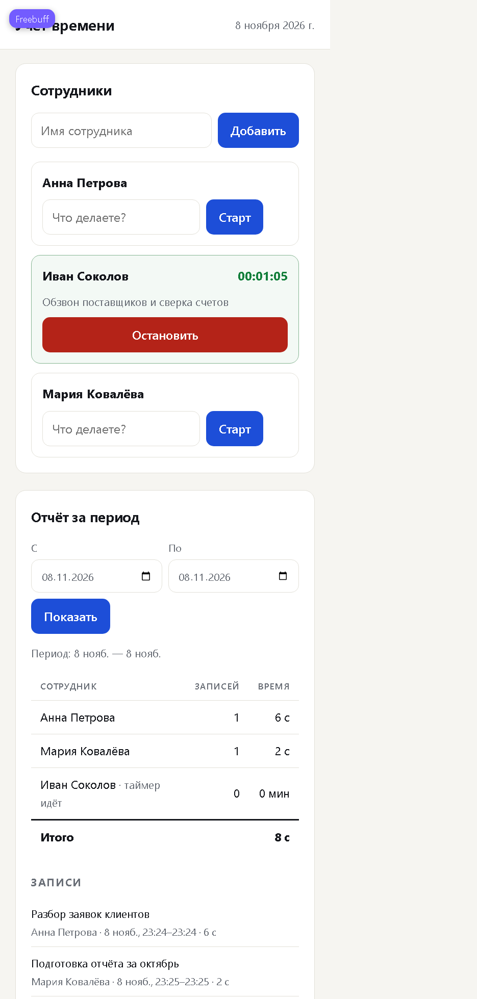

# Учёт рабочего времени

Небольшое веб-приложение для учёта времени сотрудников: список сотрудников, таймер задачи с описанием, отчёт по каждому сотруднику за выбранный период. Данные хранятся в JSON-файле и переживают перезапуск.



## Что умеет

- добавлять сотрудников;
- запускать таймер с описанием задачи и останавливать его;
- показывать активный таймер с посекундным отсчётом (переживает перезагрузку страницы и перезапуск сервера);
- строить отчёт за период: время и число записей по каждому сотруднику, итог, список записей с описанием, датой и интервалом;
- запрещать второй таймер тому же сотруднику (ответ 409 с понятным текстом);
- сохранять всё в `data/db.json`.

Авторизации и ролей нет — по условию задачи.

## Стек

- **Node.js 20+**, встроенный `node:http`, без единой внешней зависимости: `npm install` не нужен.
- Фронтенд — нативный HTML/CSS/JS без сборки.
- Хранилище — JSON-файл с атомарной записью (временный файл + `rename`).
- Тесты — встроенный `node:test`.

Такой набор выбран, чтобы проект запускался одной командой на любой машине с Node и не тянул `node_modules`.

## Запуск

```bash
npm start
# Учёт рабочего времени: http://localhost:3000
```

Переменные окружения:

| Переменная | По умолчанию | Назначение |
|---|---|---|
| `PORT` | `3000` | порт сервера |
| `DATA_FILE` | `data/db.json` | путь к файлу данных |

Режим с автоперезапуском: `npm run dev`.

## Тесты

```bash
npm test
```

20 проверок в двух файлах:

- `tests/store.test.js` — бизнес-логика: добавление сотрудника и валидация имени, старт/стоп таймера, **повторный запуск таймера** (409 и одна запись), остановка незапущенного таймера, обязательное описание, отчёт с суммами и границами периода, **пустой отчёт**, незавершённые записи, некорректные даты, сохранение и чтение после «перезапуска» (новый экземпляр хранилища на том же файле);
- `tests/api.test.js` — HTTP: отдача интерфейса, добавление сотрудника, 400 без имени, полный цикл таймера с конфликтом 409, пустой отчёт, перевёрнутый период (400), состояние, 404 для неизвестного метода, битый JSON.

### Основные сценарии

| Сценарий | Ожидаемое поведение | Где проверяется |
|---|---|---|
| Добавление сотрудника | `201`, имя без лишних пробелов; пустое имя — `400 NAME_REQUIRED` | `store.test.js`, `api.test.js` |
| Запуск таймера с описанием | `201`, запись активна, описание обязательно | `store.test.js`, `api.test.js` |
| **Повторный запуск таймера** | `409 TIMER_ALREADY_RUNNING`, вторая запись не создаётся | `«не даёт запустить второй таймер»`, `«ведёт таймер и запрещает повторный запуск»` |
| Остановка без старта | `409 TIMER_NOT_RUNNING` | оба файла |
| Остановка таймера | длительность сохраняется, таймер снимается | оба файла |
| **Пустой отчёт** | `entries: []`, `totalMs: 0`, сотрудники с нулями; в интерфейсе — только надпись «записей нет» | `«возвращает пустой отчёт»`, `«возвращает пустой отчёт за период без записей»` |
| Отчёт за период | в сумму входят только завершённые записи, начатые внутри периода включительно | `«суммирует время по сотрудникам»`, `«не включает незавершённые записи»` |
| Перезапуск приложения | новый экземпляр хранилища читает сотрудников и записи с диска | `«читает данные после перезапуска»` |

Ручная проверка в браузере: добавление сотрудника, старт/стоп таймера, перезагрузка страницы с активным таймером, пустой период, ввод HTML-тегов в описание, ширина 375 px.

## API

| Метод | Путь | Тело / параметры | Ответ |
|---|---|---|---|
| `GET` | `/api/state` | — | сотрудники и активные таймеры |
| `GET` | `/api/employees` | — | список сотрудников |
| `POST` | `/api/employees` | `{"name": "Анна"}` | `201` + сотрудник |
| `POST` | `/api/timer/start` | `{"employeeId": "...", "description": "Задача"}` | `201` + запись; `409 TIMER_ALREADY_RUNNING` |
| `POST` | `/api/timer/stop` | `{"employeeId": "..."}` | `200` + запись и `durationMs`; `409 TIMER_NOT_RUNNING` |
| `GET` | `/api/report?from=2026-11-01&to=2026-11-08` | даты `YYYY-MM-DD` включительно | суммы по сотрудникам и список записей |

Ошибки всегда JSON: `{"error": "...", "code": "..."}`.

## Структура

```
src/store.js      хранение, таймеры, отчёт, валидация
src/server.js     HTTP-сервер, маршруты, статика
public/           интерфейс (index.html, app.js, styles.css)
tests/            node:test
data/db.json      создаётся при первом запуске, в git не попадает
```

Активный таймер — это запись с `endedAt: null`. В отчёт попадают только завершённые записи, начатые внутри периода.

## ИИ-инструменты и модели

Весь код, тесты и этот README написаны ИИ-агентом **Freebuff (Buffy)** — агент для разработки, который работает в редакторе и терминале: читает файлы, пишет код, запускает тесты и браузер.

- **Модель:** Claude (Anthropic), доступ через Freebuff. Точную версию модели интерфейс сессии не показывает, поэтому здесь она не указана.
- **Что делал ИИ:** сгенерировал сервер, хранилище, интерфейс и тесты; запускал `npm test`, поднимал сервер, проверял сценарии в браузере (добавление сотрудника, старт/стоп, перезагрузка страницы, пустой отчёт, XSS-ввод, ширина 375 px).
- **Что проверял человек:** постановку задачи и финальные решения по поведению (например, что незавершённые записи не входят в отчёт). Код в этом репозитории не писался вручную.

Другие ИИ-инструменты (Copilot, Cursor и т. п.) не использовались.

### Примеры запросов

1. «Сделай минимальное приложение учёта времени на Node без внешних зависимостей: сотрудники, старт/стоп таймера с описанием, отчёт за период, сохранение в JSON-файл. Один активный таймер на сотрудника.»
2. «Напиши тесты на `node:test`: повторный запуск таймера должен давать 409 и не создавать вторую запись; пустой отчёт должен возвращать нули и пустой список записей; данные должны читаться после перезапуска.»
3. «Проверь отчёт на границах периода: запись в 23:59:59 должна попадать в день, запись в 00:00 следующего дня — нет.»
4. «Подними сервер и проверь в браузере сценарий: добавить сотрудника, запустить таймер, перезагрузить страницу, остановить таймер, посмотреть отчёт. Найди ошибки в интерфейсе.»
5. «Проверь, что описание задачи с HTML-тегами выводится как текст и не исполняется.»

## Найденные и исправленные ошибки

Ошибки ниже реально всплыли при прогоне тестов и проверке в браузере, а не придуманы для отчёта.

1. **Тесты делили один файл данных.** Каждый тест вызывал `init()` на общем `db.json`, поэтому записи предыдущих сценариев попадали в следующие. Падало с `2 !== 1` (вторая запись таймера) и `4 !== 3` (лишние записи в отчёте). Исправлено: у каждого теста свой файл через `randomUUID()`.
2. **Пустой отчёт показывал одновременно таблицу с нулями и надпись «За выбранный период записей нет».** Таблица скрывалась по числу сотрудников, а не записей. Исправлено: `reportTable.hidden = report.entries.length === 0`.
3. **Короткая запись отображалась как «0 мин».** Таймер на 6 секунд давал в отчёте ноль. Исправлено: длительность меньше минуты показывается в секундах («6 с»).
4. **Нулевое время после этой правки стало «0 с».** Для пустого отчёта это читается хуже, чем «0 мин». Добавлено отдельное условие для нуля.
5. **В отчёте не было видно, что у сотрудника идёт таймер** — он выглядел как сотрудник с нулём. Добавлена пометка «таймер идёт».
6. **Ошибка в самом тесте API:** проверка ожидала минимум трёх сотрудников, хотя сценарий создаёт двух; тест падал на корректном коде. Ожидание исправлено на два.

Отдельно проверено, что описание с `<script>` и `` выводится текстом (`textContent`, без `innerHTML`) — XSS не срабатывает.

## Ограничения

- Один процесс, без авторизации и ролей — по условию задачи.
- JSON-файл подходит для небольшой команды; для нагрузки нужна БД.
- Если сервер упадёт во время работы таймера, запись останется активной и после старта продолжит считаться от исходного времени — отдельной «сшивки» пропущенного интервала нет.
